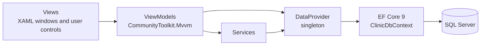

<div align="center">

# 🏥 Clinic Management System

**A Windows desktop application for running a private clinic: patients, appointments, examinations, pharmacy and billing in one place.**


</div>

---

## Overview

The app covers the daily workflow of a small clinic, from booking an appointment to dispensing medicine and printing the invoice. Each staff member signs in and sees only the screens their role needs.

## Features

| Module | What it does |
| --- | --- |
| **Patients** | Patient records, patient types, visit history and medical records |
| **Appointments** | Booking, appointment types, today's schedule and status tracking |
| **Examination** | Doctors record diagnoses and prescriptions into the medical record |
| **Pharmacy** | Medicine catalogue, categories, units, suppliers, stock-in, monthly stock, low-stock and near-expiry alerts |
| **Sales and invoices** | Medicine sales cart, invoices with line items, QR payment, PDF export |
| **Staff** | Doctors and staff, specialties, accounts and password changes |
| **Statistics** | Revenue and activity charts, Excel export |
| **Notifications** | In-app notifications for staff |

### Role-based access

| Role | Screens |
| --- | --- |
| Admin | All screens |
| Manager | Patients, appointments, stock, invoices, staff, statistics, settings |
| Doctor | Patients, examination, appointments, staff, settings |
| Pharmacist | Stock, medicine sales, patients, invoices, settings |
| Cashier | Patients, appointments, invoices, staff, settings |

## Architecture



- **MVVM** with `CommunityToolkit.Mvvm`, a `ViewModelLocator` and value converters for the UI logic.
- **EF Core** with one configuration class per entity (`Configurations/`) and migrations that map tables to Vietnamese names.
- **UI** built with Material Design in XAML; charts with LiveCharts.
- **Reports**: PDF invoices with QuestPDF and Excel export with ClosedXML.
- Passwords are stored as hashes.

## Project structure

```text
ClinicManagement/
├── Models/            entities and ClinicDbContext
├── Configurations/    EF Core entity configurations
├── Migrations/        database migrations
├── ViewModels/        one ViewModel per screen
├── UserControlToUse/  main tabs: patients, examine, appointments, stock, invoices, sales, staff, statistics, settings
├── SubWindow/         detail and dialog windows
├── Converter/         WPF value converters
├── Services/          blog, feedback, clinic services, message box
└── ResourceXAML/      styles, icons, images
ClinicManagement.Web/  web controllers for the clinic blog and patient feedback
```

## Getting started

**Requirements:** Windows, .NET 8 SDK, SQL Server (Express is fine), Visual Studio 2022.

1. Set the connection string in an environment variable:
   ```powershell
   setx CLINIC_DB_CONNECTION "Data Source=.\SQLEXPRESS;Initial Catalog=ClinicManagement;Integrated Security=True;Trust Server Certificate=True"
   ```
2. Create the database from the migrations:
   ```powershell
   dotnet ef database update --project ClinicManagement
   ```
3. Open the solution in Visual Studio and run `ClinicManagement`.

> The project references a shared `ClinicManagement.Core` library that lives outside this repository. Place it at the path given in `ClinicManagement.csproj`, or remove the reference, before building.

## Tech stack

C# · .NET 8 · WPF · CommunityToolkit.Mvvm · Entity Framework Core 9 · SQL Server · MaterialDesignThemes · LiveCharts · QuestPDF · ClosedXML

## Author

**Nguyen Minh Tho** · [@ngminhthotech](https://github.com/ngminhthotech)
